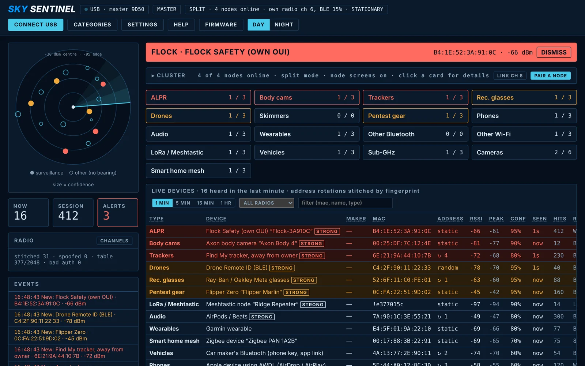
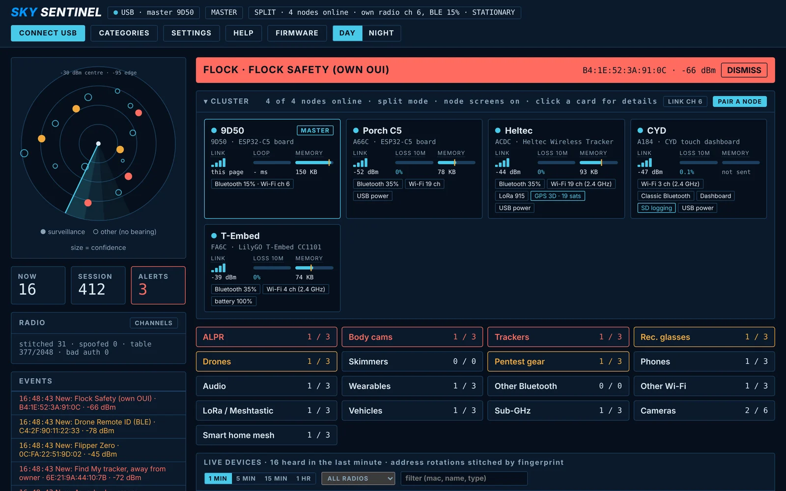
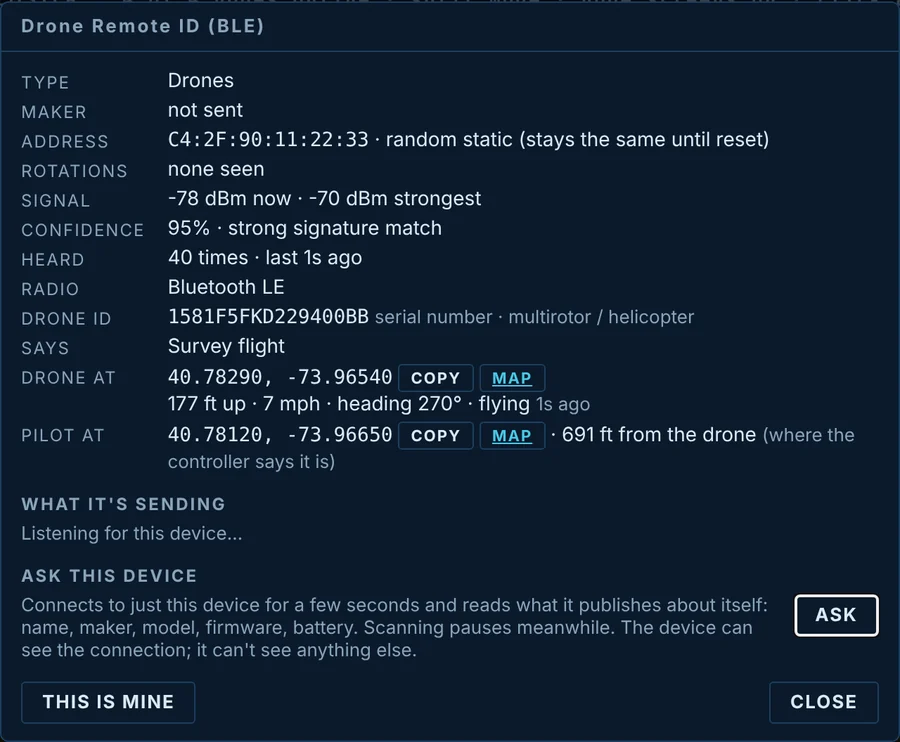
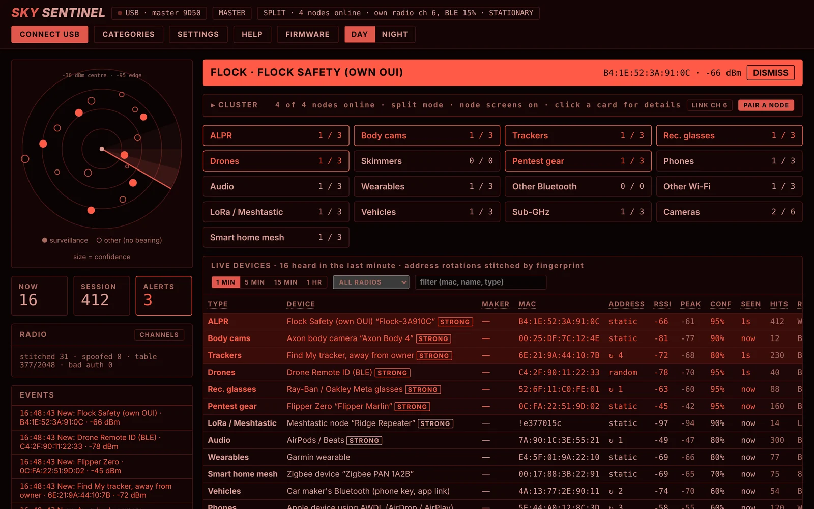
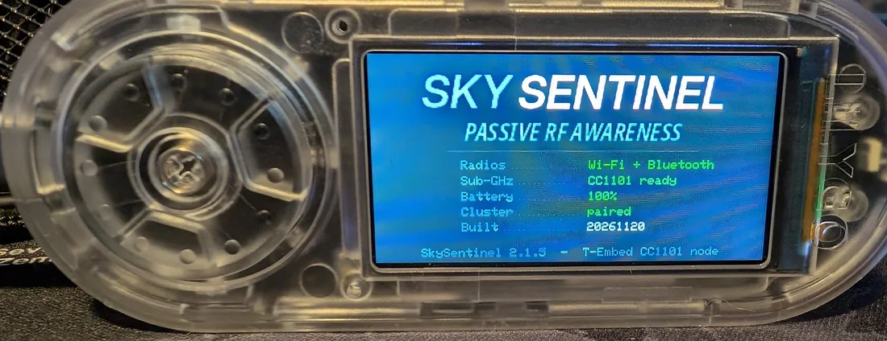
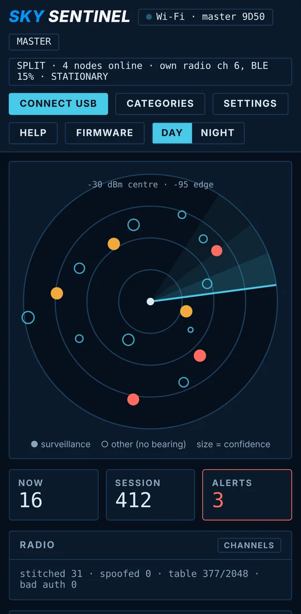
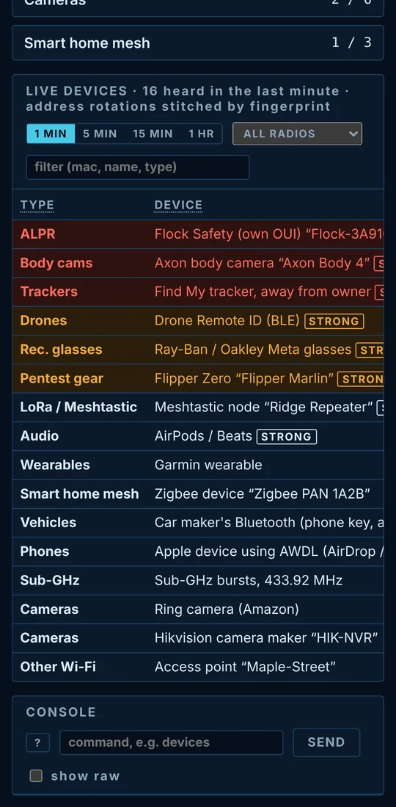

# SkySentinel

**Know what's watching.** A listen-only detector for surveillance gear and the radio
devices around you: Flock ALPR cameras, body cams, AirTags and other trackers, camera
glasses, drones (Remote ID decoded), card skimmers, Wi-Fi and Bluetooth attacks, sub-GHz
and GPS jamming, and much more. It runs on $10 to $40 ESP32 boards, alone or as a
cluster, and shows everything in a web console (over USB, or from your phone over the
board's own Wi-Fi) and on optional screens.



- **Install from your browser:** https://skysentinel.neyhard.com (no toolchain needed)
- **How-tos:** https://skysentinel.neyhard.com/docs.html
- **What's new:** [CHANGELOG.md](CHANGELOG.md) and [Releases](../../releases)
- **License:** PolyForm Noncommercial 1.0.0, free for personal and noncommercial use ([LICENSE](LICENSE))

SkySentinel listens. It records what devices broadcast openly and never jams or attacks
anything. It only transmits to a device if you choose to (the optional ASK button and
Bluetooth active scanning), and the Classic Bluetooth node's inquiries.

> **2.0 was a ground-up rewrite.** The original single-board CYD sketch (v0.5.9) lives on the
> [`legacy-cyd`](../../tree/legacy-cyd) branch and the `v0.5.9` tag.

## Screenshots

The console pictures use made-up devices.

| | |
|---|---|
|  |  |
| **The cluster:** each board's link, loss, memory and radios | **A drone's Remote ID:** serial number, position, the pilot's position |
|  |  |
| **Night mode:** red on black, for a dark car | **T-Embed CC1101:** the boot screen, then six pages on the jog wheel |

<p>
  
  
</p>

On a phone, join the master's own Wi-Fi and the same console opens by itself, in any
browser. No app, no internet.

## What it finds

| Category | Examples |
|---|---|
| **ALPR** | Flock Safety cameras and Raven gunshot sensors, Genetec plate readers |
| **Body cams** | Axon / TASER, Motorola Solutions, WatchGuard, Digital Ally, BodyWorn, Zepcam |
| **Trackers** | AirTags and Find My tags away from their owner, SmartTags, Tile, Chipolo, Google Find Hub tags |
| **Camera glasses** | Ray-Ban and Oakley Meta, Snap Spectacles, Vuzix |
| **Drones** | FAA Remote ID decoded (serial, position, height, speed, the pilot's position), DJI DroneID |
| **Skimmers** | HC-05 / HC-06-style serial Bluetooth radios found in gas pumps |
| **Pentest gear and attacks** | Flipper Zero (even renamed), Wi-Fi Pineapple, Pwnagotchi, Evil-M5 / Bruce / GhostESP gear, Chameleon card cloners; evil twins, beacon and Bluetooth spam, deauth floods, forged channel switches, WPA3 floods, sub-GHz jamming, GPS jamming and spoofing |
| **Cameras** | Doorbells and home / business cameras by maker: Ring, Hikvision, Verkada, Wyze, Arlo, Axis, Blink, GoPro |
| **Vehicles** | Tire pressure sensors (T-Embed CC1101: Toyota, Ford, GM, Hyundai / Kia, Honda, Jeep and more), phone-key cars (Tesla and 13 other makers), car hotspots and stereos, OBD-II dongles, e-bikes and scooters |
| **Smart home mesh** | Zigbee and Thread / Matter devices and networks (C5 nodes) |
| **LoRa** | Meshtastic nodes (names and positions on the public channel), MeshCore, LoRaWAN devices |
| **Sub-GHz** | Fob, remote and sensor bursts on 314.35 to 915 MHz (T-Embed CC1101) |
| **Everything else** | Phones (even already on Wi-Fi), AirDrop, Wi-Fi Direct, earbuds with battery levels, wearables, routers with their security and load |

Strong matches raise an alert, weaker ones a notice; a device that follows you across
places, or lingers while you're parked, raises its own. Finds go in a log with GPS time
and place. Details, sources and credits: [docs/detection.md](docs/detection.md).

## Boards

| Board | Chip | Adds | Roles |
|---|---|---|---|
| ESP32-C5 DevKitC-1 | ESP32-C5 | Wi-Fi 2.4 + 5 GHz, Bluetooth LE, Zigbee / Thread (as a node), phone page | **best master**, standalone, node |
| Heltec Wireless Tracker | ESP32-S3 | LoRa 915, GPS (time, place, jamming / spoofing alarms), screen | node, master, standalone |
| LilyGO T-Embed CC1101 | ESP32-S3 | Sub-GHz band watch and jamming, screen, jog wheel, LED ring, foxhunt | node, master, standalone |
| CYD / ESP32-32E 2.8" | ESP32 | Touch dashboard, SD log, Classic Bluetooth, speaker, optional GPS | node |
| ESP32-WROOM-32 DevKit | ESP32 | Classic Bluetooth, more Wi-Fi ears | node |
| Marauder V8 | ESP32-C5 | A C5 master with a screen and battery (beta: screen and SD not supported yet) | master, standalone, node |

Every board of a kind runs the same firmware. Whether it's standalone, the master or a
node is a setting, so changing roles never needs a reflash. Board guides:
[docs/boards.md](docs/boards.md).

```
 Nodes (any mix)                                         Master                        You
 ESP32-C5 (Wi-Fi 2.4 + 5 GHz, BLE, Zigbee)  ─┐
 Heltec Tracker (LoRa, GPS)                  ├─ ESP-NOW ─→ C5 / V8 / Heltec / T-Embed ─→ web console (USB or Wi-Fi)
 CYD (Classic BT, touch dashboard)           │  encrypted,  device table, alerts, log    CYD dashboard, SD log
 T-Embed CC1101 (sub-GHz)                   ─┘  paired      link on ch 1, 6 or 11
```

## Quick start

1. **Install:** open https://skysentinel.neyhard.com in Chrome, Edge or Firefox 151+ on a
   desktop, pick the board, choose **Fresh install**. Or build it yourself (below).
2. **Open the console:** the site's console, or `webui/index.html` from this repository,
   and press **CONNECT USB**. The setup screen asks what the board is: **Standalone** for
   one board, **Master** if you'll add nodes.
3. **Add nodes:** flash them, then **PAIR A NODE** on the master's page, hold the new board
   close, check the 6-digit code matches, **ACCEPT**.

The master can also run its own Wi-Fi network and serve the console to a phone, no app
and no internet needed (SETTINGS > Wi-Fi access point).

## Building

```
pio run -e c5 -t upload       # ESP32-C5 DevKitC-1
pio run -e v8 -t upload       # Marauder V8
pio run -e heltec -t upload   # Heltec Wireless Tracker
pio run -e tembed -t upload   # LilyGO T-Embed CC1101
pio run -e cyd -t upload      # CYD / ESP32-32E
pio run -e classic -t upload  # ESP32-WROOM-32 DevKit
make -C test/host             # host tests (2,500+ checks under ASan / UBSan)
```

Add `--upload-port /dev/serial/by-id/...` when more than one board is plugged in.
Layout, tests and the website build: [docs/development.md](docs/development.md).

## Documentation

| | |
|---|---|
| [docs/cluster.md](docs/cluster.md) | Roles, pairing, how work is shared, the link channel, Long Range, the cluster view |
| [docs/detection.md](docs/detection.md) | Signatures and sources, what the radios give away, following alerts, how devices are filed |
| [docs/boards.md](docs/boards.md) | Classic node, CYD dashboard, Heltec LoRa node, T-Embed sub-GHz node |
| [docs/console.md](docs/console.md) | The web console, Wi-Fi access, serial commands, logging, the detection log, HISTORY and SD cards |
| [docs/development.md](docs/development.md) | Code layout, building, tests, the website |

**HELP** in the console has the plain-language version: what each board contributes, how
to read the screen, how devices are identified, and what SkySentinel can't see.

## Credits

Signatures are built from public data: the IEEE OUI registry, the Bluetooth SIG company
and service lists, the Flock research credited in `ss_sigdata.h` (DeFlock, ouispy-detector,
flock-you, GainSec's Raven work, nyanBOX), the Nearby Glasses app, the DJI DroneID research and
[Dragon Detector](https://github.com/valleytechsolutions/Dragon-Detector) and
[Evil-M5Project](https://github.com/7h30th3r0n3/Evil-M5Project) (identifiers only), and the
rtl_433 project's TPMS wire formats (our own decoder). Details in [docs/detection.md](docs/detection.md) and `lib/sscore/ss_sigdata.h`.
Third-party code keeps its own license ([THIRD_PARTY.md](THIRD_PARTY.md)).

## License

Copyright 2026 Robert Neyhard. SkySentinel is free for non-commercial use under the
PolyForm Noncommercial License 1.0.0 (`LICENSE`, SPDX `PolyForm-Noncommercial-1.0.0`):
use it, study it, change it, share it. Selling it or using it in a business needs
written permission.
